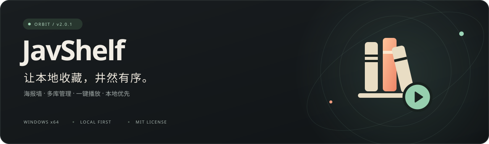
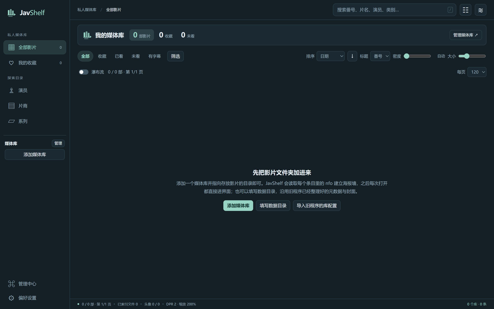

<p align="center">
  
</p>

<p align="center">
  <strong>把散落在文件夹里的影片，整理成一座属于自己的媒体库。</strong><br />
  面向 Windows 的本地 JAV / 视频媒体库管理器，以现有 NFO 与封面为基础，不必重新整理文件目录。
</p>

<p align="center">
  <a href="https://github.com/r1907200753/JavShelf/releases/latest"><strong>下载 Windows 版</strong></a>
  &nbsp; · &nbsp;
  <a href="#三步开始">快速开始</a>
  &nbsp; · &nbsp;
  <a href="#它能做什么">功能概览</a>
  &nbsp; · &nbsp;
  <a href="https://github.com/r1907200753/JavShelf/issues">反馈问题</a>
</p>

---

## 你的媒体库，从这里开始



<p align="center"><sub>真实软件截图 · 全新空库 · 无示例影片、媒体封面或个人数据</sub></p>

**Orbit 工作台**将导航、海报墙与详情抽屉放在同一个工作空间。浏览归浏览，管理归管理——常用操作随手可达，设置与后台任务收进管理中心。

## 它能做什么

| 能力 | 体验 |
| :--- | :--- |
| **一面墙，看见所有收藏** | 海报墙、关键词搜索、多维排序与筛选；显示密度可调，按自己的节奏浏览。 |
| **多个目录，一个入口** | 添加本地或已挂载的媒体目录，独立启用不同媒体库；支持新增、删改和覆盖刷新。 |
| **不离开视线的详情** | 单击海报展开侧边抽屉，双击打开完整详情；播放、收藏、已看和打开文件夹集中呈现。 |
| **不止按影片查找** | 从演员、片商或系列进入收藏；管理头像、补充资料，手动绑定 JavDB 条目。 |
| **重复影片，先看清再决定** | 分别列出完全重复与近似重复，只提供报告和定位入口，不自动删除文件。 |
| **浏览器与本地库连起来** | 可选 Chrome / Edge 扩展，在支持的站点显示本地收录状态，并调用本地播放器。 |

另有 NFO 编辑、封面裁切、头像导入、托盘后台与可选的手动资料抓取。

## 三步开始

1. **下载并解压**：在 [最新发布](https://github.com/r1907200753/JavShelf/releases/latest) 下载 `JavShelf-v2.0.2-windows-x86_64.zip`，完整解压到可写目录，再运行 `JavShelf.exe`。无需安装 Node.js。
2. **添加媒体库**：打开「管理媒体库」，选择自己的影片目录。已有的 `.nfo` 与 `-poster / -fanart / -thumb.jpg` 可直接用于建立海报墙。
3. **开始浏览**：单击海报看详情，使用「播放」调用系统默认播放器；也可以在设置中指定播放器。

> **运行环境**：Windows x64。请保留解压后的完整目录，不要单独移动 EXE，也不要在压缩包内直接运行。

## 本地优先，边界清楚

- **干净发布**：新版源码与发布包不含个人媒体库、影片、Cookie 或登录凭据；首次运行为空库。
- **数据在自己手中**：便携运行时，配置保存在程序旁的 `config.json`，主数据库位于 `JavShelf-data/`。如果设置了自定义「数据目录」，头像和自定义封面等会保存在该目录；迁移或备份时，需一并保留配置、`JavShelf-data/`、自定义数据目录及原始媒体文件。
- **删除记录不等于删除影片**：从库中移除记录不会删除视频、封面或 NFO。手动覆写 NFO、封面时会先生成 `.bak` 备份，重要资料仍建议自行备份。
- **联网由你决定**：JavDB 等资料抓取需手动触发；浏览器本地桥接默认关闭。登录 Cookie 属于个人凭据，请勿上传或分享配置文件。

<details>
<summary><strong>可选：连接 Chrome / Edge 扩展</strong></summary>

1. 在 JavShelf 的设置中开启「浏览器拓展」本地桥接。
2. 打开浏览器的扩展管理页，启用开发者模式，选择「加载已解压的扩展程序」。
3. 选择发布包内的 `resources/app/extension/`；从源码使用时选择 `extension/`。
4. 在扩展选项中确认端口与软件一致，默认端口为 `45789`。

扩展支持 JavDB / JavBus 的收录标记与本地播放；附加域名需自行授权。本地服务仅监听 `127.0.0.1`，查询不返回影片路径。无需扩展时，保持桥接关闭即可。

</details>

<details>
<summary><strong>可选：从源码运行</strong></summary>

需要 Windows、Node.js 24 与 npm。在项目目录执行：

```bash
npm ci
npm start
```

`npm run zip` 生成 Windows x64 ZIP；`npm run dist` 生成解包目录。依赖版本以锁文件为准。公开仓库保留运行源码与必要构建配置，不附带内部施工文档或私人测试资料。

</details>

<details>
<summary><strong>常见问题</strong></summary>

**为什么第一次打开没有影片？** 这是正常状态，发布包不预装媒体内容。添加自己的目录后再建立索引。

**挂载盘也能用吗？** 可以选择已经挂载、能够访问的目录。首次扫描及图片加载速度取决于存储与网络状态。

**能自动下载影片吗？** 不能。JavShelf 管理已有的本地文件，不内置、分发或下载影片。

**反馈问题要提供什么？** 请说明版本、复现步骤与已脱敏截图，不要附上 Cookie、完整配置、数据库或私人目录清单。

</details>

## 许可与致谢

采用 [MIT 许可证](LICENSE)。感谢 Electron、Node.js 与 undici；早期界面布局参考 [JavBoss](https://github.com/Solr159/JavBoss)，当前界面为独立实现的 Orbit 工作台。

本项目由 AI 辅助开发，需求、方案与验收由维护者把关。软件按「现状」提供，不作任何保证；请仅用于合法的个人本地媒体管理，并遵守第三方数据来源的使用条款。
