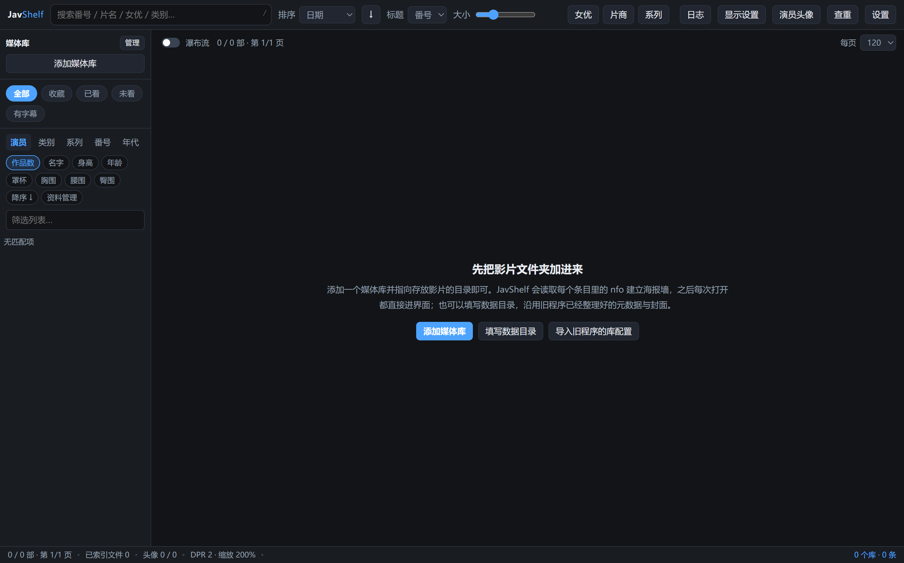

# JavShelf

本地 JAV / 视频媒体库管理器：读影片文件夹里的 `.nfo` 与 `-poster / -fanart / -thumb.jpg`，
建海报墙，双击直接播放本地文件。为替换一个已停更的旧程序（易语言/EXUI 写的）而从零重写，
界面 clean-room 自行编写，MIT 许可。

当前版本 v1.7.1（2026-09-26）。发布形态：文件夹 + zip，另有单文件便携 exe。
每轮施工记录与决策原因见 [CHANGELOG.md](CHANGELOG.md)。

## 快速入门

1. 到 [Releases](../releases) 下载 `JavShelf-v1.7.1-windows-x86_64.zip`，解压后运行
   `JavShelf.exe`。干净包：不含任何库数据、Cookie 与登录凭据，首次运行是空库。
2. 点「添加媒体库」，指向存放影片的文件夹即可（也支持「导入旧程序的库配置」）。
3. 仅支持 Windows x64。

## 主界面

首次运行（空库）：

## 主要能力

- 多库管理：每个库指向一个影片文件夹，自动读 nfo 建库；新增 / 删改 / 覆盖三种刷新，进度实时显示。
- 海报墙：虚拟化渲染、高分屏矢量出图，瀑布流无限加载；按演员 / 类别 / 系列 / 番号 / 年代分面筛选，多维排序。
- 详情侧栏：元数据、剧照、播放 / 收藏 / 已看、编辑 nfo、从 JavDB 覆写。
- 二级界面：女优 / 片商 / 系列三面封面墙，封面可编辑。
- 女优资料：导入与编辑，罩杯 / 三围 / 身高等自动归一；可手动绑定 JavDB，可从日文维基补全。
- 资料抓取：JavDB 女优目录 / 演员页 / 影片页，头像下载与导入；全部手动触发，绝不自动跑。
- 自定义封面：导入图片裁切替换，可选写回影片文件夹（覆写前自动备份）。
- 查重：只读报告，完全重复与近似重复两层分开报，跨库也算。
- 播放与后台：默认交系统播放器，可指定播放器程序；支持最小化到托盘。

## 数据边界

- 任何删除都不碰视频、图片与 nfo 文件本身；覆写 nfo / 封面前先留 `.bak` 原字节备份。
- 程序自己产生的一切数据写在 exe 旁边的 `JavShelf-data\`，不写入旧程序的数据目录。
- `config.json` 里 `javdbCookie` 是登录凭据，不要外发；发布包绝不含 Cookie。

## 许可与出处

- MIT。独立实现（clean-room），未复制任何第三方源码。
- 界面参考了 [JavBoss](https://github.com/Solr159/JavBoss)（GPL-3.0）的布局与配色，
  全部 HTML / CSS / JS 由本项目自行编写，未使用其代码或资源。
- 沿用旧程序留在磁盘上的数据格式（库表、图片分桶目录、视频目录内的
  `-poster / -fanart / -thumb.jpg` 与 `.nfo`）。

## 鸣谢

- [Electron](https://www.electronjs.org/) 与 [Node.js](https://nodejs.org/)（含 `node:sqlite`）：
  本项目的运行时底座。
- [undici](https://github.com/nodejs/undici)：代理与 HTTP 客户端。
- [JavBoss](https://github.com/Solr159/JavBoss)：界面布局与配色的参考来源。
- [JavDB](https://javdb.com/) 与[日文维基百科](https://ja.wikipedia.org/)：女优资料抓取的数据来源，
  抓取全部手动触发、带节流与退避，请遵守对方站点的使用条款。
- 已停更的旧程序（易语言/EXUI 写的本地媒体库管理器）：它留下的磁盘格式是本项目存在的理由。
- 本项目全程由 AI 辅助编码完成（见下方声明），提交记录与回归测试为真实执行结果。

## 风险提示与免责声明

- 本项目仅供学习与个人本地媒体管理使用。使用者须遵守所在国家或地区的法律法规；
  对任何违法内容的获取、持有与传播，作者不承担任何责任。
- 本软件不内置、不分发、不下载任何影片数据；仓库与发布包均为干净包，
  不含媒体库、图片、`config.json` 真实内容与登录凭据。
- 「资料抓取」直连第三方站点，可能违反其服务条款或导致 IP 被限；Cookie 属个人登录凭据，
  任何情况下不要外发。抓取永远是手动触发，程序绝不自动跑。
- 软件会读写你磁盘上的 `.nfo` 与封面文件：覆写前会生成 `.bak` 原字节备份，
  但仍建议对重要数据自行备份。任何删除操作都不碰视频、图片与 nfo 文件本身。
- 本软件按「现状」提供，不作任何明示或暗示的保证；因使用本软件造成的数据丢失、
  设备损坏或其他后果，作者不承担责任。

## 关于 AI 生成

本项目的代码、文档与提交说明主要由 AI 辅助生成，人类负责需求定义、方案决策、
逐轮验收与实测。CHANGELOG 中的「实测」数字来自真实运行的 49 步端到端回归
（`npm run smoke`），不是编造的样例；但文档表述可能存在 AI 特有的偏差，
以代码与实际运行结果为准。
